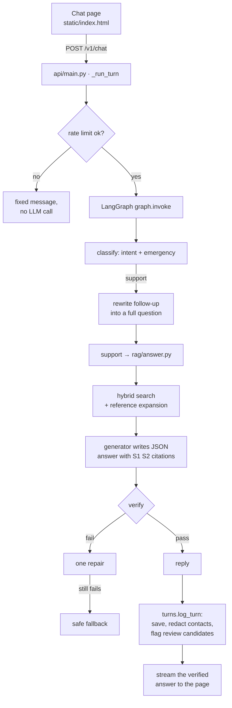

# Code guide — BrightSmile bot

A lesson-by-lesson walk through the codebase: what each part does, how it works, why it was
built that way, and what an interviewer is likely to ask. Every claim points to a file and line
(`path:line`) or to a measured number in [`docs/results.md`](results.md).

| # | Lesson | Main files |
|---|---|---|
| 0 | [Big picture](#lesson-0--big-picture) | `configs/`, `Makefile` |
| 1 | Config & LLM layer | `src/bot/config.py`, `src/bot/llm/` |
| 2 | Knowledge-base ingestion | `src/bot/retrieval/loaders.py`, `chunking.py`, `ingest.py`, `src/bot/db/` |
| 3 | Hybrid retrieval | `src/bot/retrieval/hybrid.py` |
| 4 | Grounded answering + self-verification | `src/bot/rag/` |
| 5 | Conversation flow (LangGraph) | `src/bot/graph/`, `src/bot/leads/` |
| 6 | API & product | `src/bot/api/` |
| 7 | Evaluation | `evals/` |
| 8 | CI/CD & deployment | `.github/workflows/`, `Dockerfile` |
| 9 | Feedback loop & experiments | `evals/review_cli.py`, `spot_checks.py`, `ragas_check.py` |
| 10 | Tests & wrap-up | `tests/` |

---

## Lesson 0 — Big picture

### Purpose
A support chatbot for a (fictional) dental clinic. It answers patient questions **only from the
clinic's own documents**, cites them, checks every answer before showing it, captures leads only
with consent, hands chats to staff, and is guarded by an **evaluation suite that runs on every
pull request** and blocks changes that make answers worse.

### The folder map
| Folder | What lives there |
|---|---|
| `data/kb/` | The knowledge base: clinic documents in PDF, DOCX, Markdown and CSV, plus `manifest.json` (id, title, status of each document) |
| `configs/` | Every tunable value: models (`models.yaml`), search settings (`retrieval.yaml`), clinic facts and fixed messages (`generation.yaml`), CI gate rules (`gate.yaml`) |
| `prompts/` | The instructions given to each LLM call (answer, verify, classify, rewrite, lead extraction, judge) |
| `src/bot/llm/` | One small layer that talks to the LLM providers (Groq, Gemini), with retries and a cache |
| `src/bot/retrieval/` | Loading documents → splitting into chunks → embedding → indexing in Postgres → searching |
| `src/bot/rag/` | Turning search results into a cited answer, then verifying it |
| `src/bot/graph/` | The conversation flow (LangGraph): which path a message takes |
| `src/bot/api/` | The web server (FastAPI), the chat page and the staff page |
| `src/bot/leads/`, `src/bot/db/` | Saving leads; the database schema and migrations |
| `evals/` | The test set ("golden set"), the eval runner, the LLM judge, the CI comparison, review tools |
| `tests/` | 112 unit/integration tests (no real LLM calls: scripted fakes) |
| `.github/workflows/` | CI: lint + tests, and the eval gate |

### The life of one message
What happens when a patient types *"How much is a root canal?"* on the chat page:



In code, in order:
1. `src/bot/api/main.py:176` `chat()` receives the request, and `_run_turn` (`:107`) does the work.
2. `:110` the rate limiter is checked **before** any LLM call.
3. `:136` the LangGraph graph runs: `src/bot/graph/nodes.py:91` `classify` → `:102` `route` →
   `:132` `rewrite` → `:145` `support`.
4. `support` calls the answer pipeline: `src/bot/rag/answer.py:171` `answer()` → search at `:178`
   (`src/bot/retrieval/hybrid.py:96`, plus `expand_references` at `:136`) → generate → verify
   (`answer.py:149`, `src/bot/rag/verify.py`) → repair or fallback (`answer.py:120`).
5. `main.py:152` saves the turn (`src/bot/api/turns.py:46`), masking phone numbers and emails
   (`turns.py:21`) and flagging bad turns as review candidates (`turns.py:115`).
6. `main.py:188` streams the **already verified** answer back over Server-Sent Events.

Other paths from `route`: booking intent → `lead` (consent flow), a request for a person →
`handoff` (staff page), greetings → `greet`, off-topic → `refuse`, and while staff hold the chat
→ `staff` (the message is relayed, the bot stays quiet unless it's an emergency).

### Config drives behaviour
Almost every decision is a value in `configs/`, not code. A few examples:

```yaml
# configs/models.yaml — which model does which job ("roles")
roles:
  generator: { provider: groq, model: qwen/qwen3.8-27b, max_tokens: 1024, temperature: 0 }
  utility:   { provider: groq, model: openai/gpt-oss-20b, reasoning_effort: low }   # classify, rewrite, verify
  judge:     { provider: groq, model: openai/gpt-oss-120b, reasoning_effort: medium } # evals only
```

| Setting | File | Why it's config |
|---|---|---|
| Model per role | `models.yaml` | Swapping a model is an experiment, not a code change (the comments record why each was chosen) |
| `lexical_weight: 0.3`, `rrf_k: 60`, `top_k: 6` | `retrieval.yaml` | Tuned by measurement; the comment keeps the sweep results |
| Clinic name, phone numbers, fallback and consent texts | `generation.yaml` | One source of truth; prompts fill them in, so no clinic facts are hard-coded in prompts |
| Gate thresholds | `gate.yaml` | CI rules are reviewable in one place |

### Why it's built this way
- **Grounding over fluency.** A clinic bot that invents a price or a policy is worse than one that
  says "please call reception". So every answer is cited and checked, and a failed check means a
  safe fallback.
- **Small, swappable pieces.** Each folder does one job: search doesn't know about the API,
  answering doesn't know about LangGraph. This made each part testable and measurable on its own.
- **Measure, then decide.** Search weights, chunking, model choice and the judge were all picked by
  experiments recorded in `docs/results.md`, not by guessing.
- **Free tiers.** Groq and Gemini free tiers shaped many choices (caching every LLM call, rate
  limits, a small utility model for cheap steps).

### Limits
- The free LLM quota caps capacity (about 1–2 full answers a minute for the whole site).
- Some state (staff presence, rate-limit counters) lives in server memory, which assumes one
  server instance.

### Interview questions
1. **"Walk me through what happens when a user sends a message."** Rate limit → classify intent →
   rewrite follow-ups → hybrid search → generate a cited JSON answer → verify each claim against
   its source → one repair or a safe fallback → log with redaction → stream the verified answer.
2. **"Why not stream tokens straight from the model?"** Because the answer is verified first. A
   streamed answer could show text that the verifier later rejects.
3. **"How do you stop the model making things up?"** Retrieval-only grounding, mandatory
   citations, a code-level check that ₹ amounts and service codes appear in the cited source, an
   LLM claim check, then fallback. Measured faithfulness and citation accuracy are both 1.00.
4. **"What would you change to scale it?"** A paid LLM tier first, then a paid host; move
   in-memory state to Postgres/Redis before running more than one instance.

### Try it yourself
```bash
docker compose up -d --wait db
uv run python -m bot.rag.ask "How much is a root canal?" --debug   # one answer, with sources and checks
```
